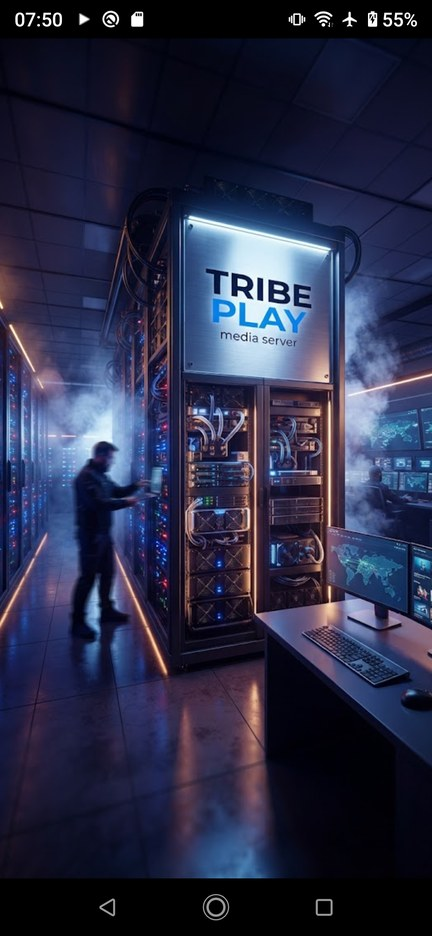

# Tribe Launcher

Minimalistički Android launcher: na početnom ekranu je **samo tvoja slika**. Nema ikona, widgeta
ni pretrage, a aplikacije se pojave tek kad ih zatražiš.

<p align="center">
  
</p>

## Šta radi

- **Čist početni ekran:** preko cijelog ekrana je izabrana slika, bez ičega preko nje
- **Fioka sa aplikacijama:** prevuci nagore i pojave se sve aplikacije, abecedno, u 4 kolone
- **Sve ikone:** ako aplikacija ima više ikona za pokretanje, prikazuju se sve
- **Uvijek ažuran spisak:** nova ili uklonjena aplikacija odmah se vidi u fioci
- **Izbor pozadine** iz fioke:
  - **Izaberi sliku** — bilo koja slika iz galerije
  - **Sistemska** — vrati sistemsku pozadinu telefona
- **Zatvaranje fioke:** prevuci nadolje, dodirni ručicu na vrhu ili pritisni Home

## Instalacija

1. Skini APK iz [Releases](../../releases) ili iz zadnjeg [Actions](../../actions) builda
2. Instaliraj ga na telefon (Android 8.0 ili noviji)
3. Pritisni Home i izaberi **Pure Launcher** kao početni ekran (**Uvijek**)

## Build

Kotlin + Jetpack Compose, minSdk 26, targetSdk 34.

```
gradle assembleDebug
```

GitHub Actions sam napravi APK na svaki push na `main` (artefakt `PureWallpaperLauncher-APK`).
